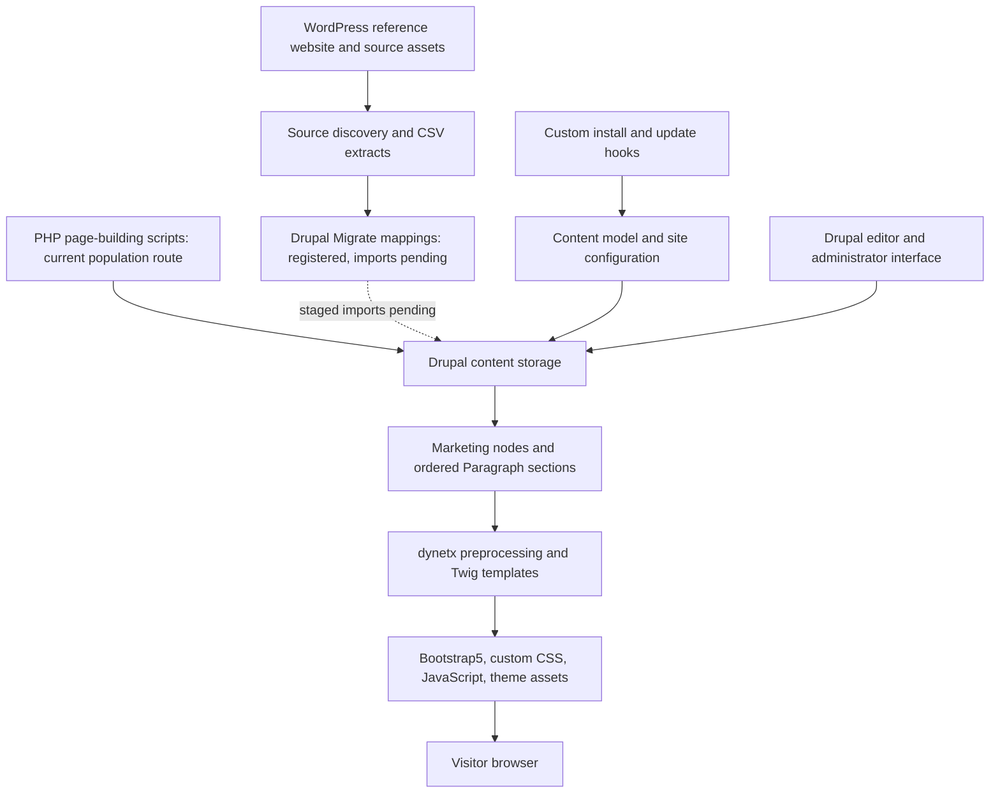
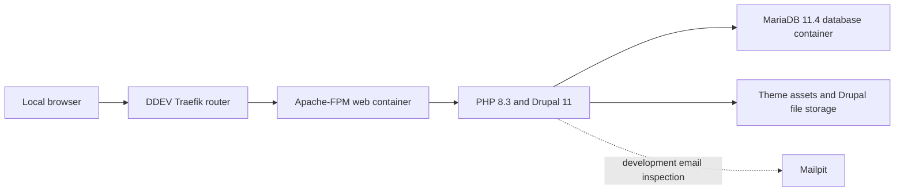

# Dyne Therapeutics
## Project Architecture, Implementation Approach, and Delivery Status

**Prepared for:** Client and project stakeholders  
**Assessment date:** October 7, 2026  
**Project:** WordPress-to-Drupal website migration  
**Reference website:** https://www.dyne-tx.com/  
**Verified local environment:** https://dyne-tx.ddev.site/  
**Document status:** Architecture and implementation assessment, not production acceptance certification

## 1. Executive Summary

The project is migrating the Dyne Therapeutics corporate website from WordPress to Drupal 11 while retaining its existing brand, information architecture, content intent, and visual experience. The approach is an **as-is migration**, not a website redesign.

The implemented foundation is a server-rendered Drupal website with a custom Bootstrap5-based theme and reusable Paragraph components. A custom migration module defines the intended content structure, taxonomy, navigation, and CSV migration mappings. PHP page-building scripts have populated the current marketing pages independently of those migrations.

Current read-only checks confirm a functioning local Drupal environment with **22 published marketing pages, 100 Paragraph entities, six installed content types, twelve installed Paragraph types, five taxonomies containing 24 terms, and 30 URL aliases**. All four registered CSV migrations are idle with **zero imported records** and **48 unprocessed source rows**. The database contains **zero managed file records and zero redirects**.

The distinction is important: the project has demonstrated the presentation and page-composition architecture, but it has **not yet demonstrated a complete, repeatable content migration or a production-ready release**. Reusable jobs, people, stories, news, and pipeline-program content types are installed but currently contain no nodes. Some information is instead embedded inside marketing-page sections as JSON or scripted content.

**Recommended next milestone:** reconcile the active schema with the migration mappings, establish version-controlled configuration, approve the complete source inventory, and execute a staged migration followed by measurable content, URL, media, interaction, and visual acceptance testing.

No overall completion percentage or delivery estimate is assigned. Neither can be supported without an approved full source inventory, scope decisions, and a resourced delivery plan.

## 2. Assessment Basis

This report combines repository inspection, current read-only DDEV/Drush/database checks, a local homepage browser inspection, and the existing October 1 implementation-status report.

| Evidence category | Meaning in this report |
| --- | --- |
| Runtime verified | Observed in the local Drupal environment on October 7, 2026 |
| Code implemented | Defined by repository code or templates; does not alone prove operational correctness |
| Historically reported | Recorded in the October 1 report; not automatically treated as current |
| Planned or recommended | Documented intent or proposed future work, not a completed capability |

The assessment also includes HTTP response checks for 35 local routes. It does not certify production infrastructure, exhaustive WordPress parity, migration rollback, full browser/device coverage, form delivery, accessibility compliance, performance, security, or disaster recovery. No content import, configuration import, deployment, or destructive page-builder run was performed for this assessment.

The root and module READMEs describe an earlier scaffold and include larger indicative content counts and Layout Builder terminology. Those statements are not treated as the current implemented architecture or an approved source inventory.

## 3. Objectives and Scope

### 3.1 Established Direction

- Preserve the existing Dyne brand and website experience rather than introduce a redesign.
- Use Drupal 11 as the content-management platform.
- Build curated marketing pages from reusable Paragraph sections.
- Preserve approved WordPress paths or provide approved redirects where paths change.
- Support structured content for jobs, leadership, patient/perspective stories, news, and pipeline programs.
- Reuse suitable Drupal contributed modules for administration, migration, SEO, forms, and browser interactions.
- Compare Drupal pages against the WordPress reference during visual and functional QA.

### 3.2 Implemented Page Inventory

The current marketing-page inventory comprises the following 22 aliases. The home page is also configured as the site's front page.

| Area | Current marketing-page aliases |
| --- | --- |
| Corporate | `/home`, `/about-us`, `/corporate-responsibility`, `/careers-culture` |
| Platform and research | `/our-forcetm-platform`, `/our-forcetm-publications`, `/pipeline` |
| Programs | `/dyne-251-for-dmd`, `/dyne-101-for-dm1`, `/dyne-302-for-fshd` |
| Disease information | `/dmd`, `/dm1`, `/fshd` |
| Clinical and community | `/clinical-trials`, `/our-commitment`, `/resources`, `/perspectives`, `/community-letter` |
| Legal and policies | `/privacy-policy`, `/terms-of-service`, `/cookie-declaration`, `/community-guidelines` |

This is the Drupal inventory, not proof that every source WordPress page or reusable record has been migrated. The contact form is a separate Webform route and is not included in the 22 marketing-page nodes.

## 4. Architecture Overview

### 4.1 Logical Architecture

### 4.2 Architecture Layers

| Layer | Responsibility | Current implementation |
| --- | --- | --- |
| Source | WordPress content, URLs, brand assets, reference behavior | Live reference website and repository CSV snapshots |
| Migration | Source-to-Drupal field transformation and traceability | Four CSV migration definitions; no imported records |
| CMS and data | Content entities, revisions, taxonomy, configuration | Drupal 11 and MariaDB |
| Page composition | Ordered reusable marketing sections | Paragraphs referenced from `dyne_page` nodes |
| Presentation | HTML output and reference-site visual treatment | Custom `dynetx` theme with Bootstrap5 base |
| Interaction | Navigation, modal dialogs, carousel, video hooks | Drupal behaviors and Bootstrap-based JavaScript |
| Supporting services | Forms, SEO, redirects, cookies, administration | Contributed dependencies; readiness varies by feature |
| Local operations | Containers, CLI, database, development services | DDEV, Docker, Drush, Composer |

There is no separate SPA frontend or headless content API integration evidenced in the custom implementation. The primary visitor experience is Drupal-rendered HTML.

### 4.3 Local Runtime Topology

The assessed environment is a Windows workstation accessing the project through Ubuntu on WSL, with DDEV using a WSL2 Docker platform. This is a **local development topology**, not an agreed production hosting design.

## 5. Technology Stack

| Technology | Role | Evidence and qualification |
| --- | --- | --- |
| Drupal 11.4.6 | CMS and request lifecycle | Runtime verified |
| PHP 8.3.30 | Server-side execution | Runtime verified; project requires PHP 8.3 or newer |
| MariaDB 11.4 | Content and configuration database | DDEV runtime verified |
| Apache-FPM | Local web serving | DDEV runtime verified |
| DDEV 1.25.2 / Docker | Local environment orchestration | Runtime verified |
| Composer | PHP and Drupal dependency management | Project manifest and lock file present |
| Drush 13 requirement | Drupal administration and migration CLI | CLI operational; Composer requirement is `^13` |
| Bootstrap5 base theme | Frontend foundation | Custom theme declares the base dependency |
| Twig | Server-rendered templates | Page, menu, node, and Paragraph templates implemented |
| Paragraphs | Component entities and page composition | Twelve types installed; 100 entities present |
| Drupal behaviors / once / jQuery | Browser behavior attachment | Declared in theme libraries |
| Node.js 20 | Available local tooling | DDEV configuration; no separate application build is established |

### 5.1 Contributed Dependency Groups

The Composer manifest includes the following groups. Package presence is not proof of complete configuration, licensing, enablement, or successful end-to-end operation.

| Group | Declared packages | Purpose |
| --- | --- | --- |
| Content and administration | Paragraphs, Admin Toolbar, CKEditor5 Premium Features | Editing and administration |
| Presentation | Bootstrap5, Layout Builder Restrictions | Theme foundation and available layout tooling |
| Migration | Migrate Plus, Migrate Tools, Migrate Source CSV | CSV imports and operational commands |
| SEO and URLs | Metatag, Pathauto, Redirect, XML Sitemap | Metadata, aliases, redirect management, sitemap generation |
| Forms | Webform | Contact and potential subscription forms |
| Media interactions | Video Embed Field, Colorbox | Video and lightbox capabilities |
| Other UX | EU Cookie Compliance, External Link Popup, Social Media Links, Better Exposed Filters | Consent, external-link handling, social links, listing filters |

CKEditor5 Premium Features licensing and external service arrangements require confirmation before production use. Availability of Layout Builder-related packages does not change the current Paragraph-based implementation into a Layout Builder architecture.

## 6. Content and Data Architecture

### 6.1 Content Types

All six types are installed. Only `dyne_page` is currently populated.

| Machine name | Intended business use | Current node count |
| --- | --- | --- |
| `dyne_page` | Corporate, scientific, community, careers, and policy pages composed from sections | 22, all published |
| `job` | Individual career positions | 0 |
| `leader` | Leadership, board, and scientific advisory board records | 0 |
| `perspective` | Perspectives and patient stories | 0 |
| `news` | Reusable news records | 0 |
| `pipeline_program` | Reusable therapeutic-program records | 0 |

Zero nodes in the reusable types does not mean all corresponding information is absent from the website. Some people, jobs, news, or program information is embedded directly in page components. That representation does not provide the same reuse, filtering, workflow, or migration traceability as standalone records.

### 6.2 Paragraph Component Catalogue

| Component type | Responsibility | Current entity count |
| --- | --- | --- |
| `dyne_hero` | Hero banner and primary title treatment | 24 |
| `dyne_icon_cards` | Icon-led feature grid | 3 |
| `dyne_pipeline_table` | Program pipeline table | 1 |
| `dyne_drug_detail` | Disease or drug detail sections | 3 |
| `dyne_team_grid` | People grid and biography presentation | 3 |
| `dyne_video` | Video and poster presentation | 0 |
| `dyne_quote_carousel` | Quotes and testimonial carousel | 1 |
| `dyne_jobs_list` | Department-grouped job listings | 0 |
| `dyne_cta` | Call-to-action band | 3 |
| `dyne_alert_banner` | Awareness or alert section | 0 |
| `dyne_news_list` | News links and dates | 3 |
| `dyne_rich_text` | Flexible formatted content sections | 59 |
| **Total** | **Installed catalogue: 12 types** | **100** |

These are database entity counts, not visible-section counts or proof that every stored entity is referenced. No orphan/revision integrity audit was performed.

### 6.3 Field Strategy

- Marketing pages reference an ordered Paragraph stack through `field_components`.
- Text, long text, link, image, taxonomy-reference, and entity-reference-revision fields are used or defined by the architecture code.
- Repeated item data is frequently represented in `field_items_json`, `field_rows_json`, and `field_sections_json`.
- Theme preprocessing decodes these JSON strings into arrays for Twig rendering.
- Install/update hooks create content-model configuration; separate scripts populate or repair page content and menus.

**Trade-off:** JSON fields and scripted content provide a quick route to reproducing complex source layouts. They reduce editorial usability, schema validation, entity relationships, and reuse compared with structured Drupal entities or nested component fields. JSON validity and trusted HTML handling must be explicitly controlled.

**Schema divergence:** the installed job type currently has `field_department_text` and `field_location_text`, whereas its migration maps `field_department` and `field_location`. The latter field configurations are absent on the installed job bundle. The repository install-hook intent is therefore not identical to the active site schema.

### 6.4 Taxonomy

| Vocabulary | Current term count | Intended use |
| --- | --- | --- |
| `disease` | 4 | Disease/program/story classification |
| `department` | 9 | Job categorization |
| `job_location` | 5 | Job location classification |
| `story_type` | 3 | Perspective, patient story, and culture classification |
| `leader_type` | 3 | Leadership, board, and SAB classification |
| **Total** | **24** | |

Vocabulary existence does not prove every intended field relationship or filter has been implemented. For example, taxonomy labels need lookup/transformation when a migration writes taxonomy entity references.

### 6.5 Views and Editorial Structure

The runtime contains standard administrative and core Views, including content, files, taxonomy, redirects, and Webform submissions. No project-specific jobs, people, perspectives, or pipeline listing View was identified in the inspected configuration names.

A production editorial approach should retain Paragraphs for page-specific composition and use structured reusable records for information that appears in multiple places. Roles, review/approval workflow, moderation, editor training, and JSON-free routine editing remain acceptance items rather than verified capabilities.

## 7. Frontend and Rendering Architecture

### 7.1 Request and Rendering Flow

1. The browser requests the front page or a URL alias.
2. Drupal resolves the route and loads the node and relevant configuration.
3. The full `dyne_page` node template renders `content.field_components`.
4. Each Paragraph bundle selects its corresponding custom Twig template.
5. Theme preprocessing exposes JSON-driven items, rows, and sections.
6. The page template supplies the global header, navigation regions, footer, and exit modal.
7. The Drupal library system loads the custom CSS and JavaScript dependencies.

### 7.2 Theme Structure

The custom `dynetx` theme defines twelve regions, including the header, primary menu, mobile drawer, content, footer, stay-in-touch area, and modal area. Sixteen custom Twig templates cover the page shell, full marketing node, main and footer menus, and twelve Paragraph types.

Presentation assets include custom CSS, self-hosted font definitions, logos, hero imagery, and icons. The frontend uses Bootstrap grid/breakpoint conventions with additional brand styling. A theme asset is not the same as a Drupal-managed image or media entity.

### 7.3 Browser Interactions

| Behavior | Implemented mechanism | Remaining verification |
| --- | --- | --- |
| Desktop navigation | Menu Twig rendering and hover behavior | Block placement, destination completeness, keyboard support |
| Mobile navigation | Bootstrap offcanvas markup | Drawer content, focus behavior, responsive usability |
| External-link warning | Custom exit-modal behavior | Destination accuracy, fallback behavior, interaction with contributed popup module |
| Quote carousel | Bootstrap-oriented carousel behavior | Controls, timing, focus, motion preferences |
| Video lightbox | Custom hook and declared lightbox dependencies | Actual video launch, close, poster rendering, accessibility |

The templates include semantic landmarks, skip-link markup, and selected ARIA attributes. These are implementation features, not evidence of WCAG compliance. The current page template also repeats the `main-content` ID, and the homepage browser snapshot exposes duplicate skip links; both warrant accessibility cleanup.

### 7.4 Visual-Parity Approach Defined So Far

The repository includes a dedicated UI-parity agent specification. Its defined approach is to compare local Drupal pages with the live WordPress reference, inspect sections from top to bottom, and correct differences through the existing theme and Paragraph components without redesigning the site.

This is a defined QA workflow, not evidence that all pages have passed. A formal parity matrix should record the reference capture date, routes, desktop/mobile sizes, screenshots, interactions, differences, resolutions, and client acceptance. This report does not claim pixel-perfect parity.

## 8. Migration Architecture and Current Approach

### 8.1 Two Distinct Population Mechanisms

**Current page population:** `create-pages.php` contains source-derived page content and component definitions, finds nodes by alias, and rebuilds their Paragraph stacks. Related scripts update selected content or repair configuration and navigation.

**Registered migration framework:** four YAML definitions use CSV sources and Drupal node destinations. They are intended to provide imports, source identifiers, and migration tracking, but they have not populated the current pages or reusable records.

The page-building script deletes existing referenced Paragraphs before recreating them. It is therefore repeatable only in a limited scripted sense: it is **not an editorially non-destructive synchronization process**. Running it after manual edits can overwrite content and affects revision integrity; it should not be used casually on an approved site.

### 8.2 Migration Inventory

| Migration | Source file | Source rows | Imported | Unprocessed | Current state |
| --- | --- | --- | --- | --- | --- |
| `dyne_pages` | `pages.csv` | 22 | 0 | 22 | Idle |
| `dyne_jobs` | `jobs-sample.csv` | 8 | 0 | 8 | Idle |
| `dyne_leaders` | `leaders.csv` | 11 | 0 | 11 | Idle |
| `dyne_perspectives` | `perspectives.csv` | 7 | 0 | 7 | Idle |
| **Total** | | **48** | **0** | **48** | |

The runtime reports zero migration messages and no last-import timestamps. This is not a successful-import result: no records have been imported. The 48 rows are the available CSV scope, not the total content of the source website.

A separate `url-map.csv` contains six redirect mappings. No dedicated redirect import definition was identified. News, pipeline programs, managed files, and media do not have dedicated migrations in the four-definition inventory.

### 8.3 Mapping Issues and Preconditions

- `dyne_pages` targets the standard `page` bundle, which is not installed; the populated marketing bundle is `dyne_page`.
- The page mapping writes the title into `body/value`; it does not migrate full source body content or construct the approved component stack.
- Job field names do not match the active schema.
- Direct source labels assigned to taxonomy-reference fields need schema-aware term lookup rather than an assumption that labels are entity IDs.
- Required rich content, portraits, documents, relationships, dates, and SEO data are not covered by the current source/mapping scope.
- Sample datasets and older README counts are insufficient for full-source reconciliation.

Resolve these issues and test in a disposable staging copy before running imports against an editorially maintained environment.

### 8.4 Recommended End-to-End Migration Sequence

1. Approve the content inventory, canonical paths, exclusions, external destinations, and source capture date.
2. Export complete source records with stable IDs, body content, metadata, taxonomies, relationships, and media references.
3. Make the active Drupal model, version-controlled configuration, and migration destinations consistent.
4. Import dependent taxonomies and files/media before records that reference them.
5. Import reusable records, then marketing pages and their approved component relationships.
6. Create aliases, redirects, navigation, and SEO configuration.
7. Reconcile source/destination totals, messages, missing references, and representative field values.
8. Perform route, visual, editorial, form, accessibility, and performance checks.
9. Obtain business approval, execute the controlled final delta/cutover, and verify rollback readiness.

This sequence is a recommendation for completion, not an already automated delivery pipeline.

## 9. Navigation, Forms, SEO, and Integrations

### 9.1 Navigation

The code defines main navigation for About Us, FORCE Platform, Pipeline, Physicians, Patients, Investors & Media, and Culture & Careers, with a separate legal footer menu. Menu destinations include both page routes and proposed subordinate routes.

The current homepage browser inspection did not expose primary menu links or footer legal links. The template regions exist, but menu rendering/block placement requires validation. Current HTTP checks confirm that all 22 marketing-page aliases, `/`, and `/form/contact` return 200. Eleven additional routes return 404:

| Route group | Currently checked 404 routes |
| --- | --- |
| Listings and general leadership | `/jobs`, `/news`, `/leadership` |
| About Us subordinate routes | `/about-us/leadership`, `/about-us/board-of-directors`, `/about-us/scientific-advisory-board`, `/about-us/contact-us` |
| Audience and other destinations | `/physicians`, `/patients`, `/benefits`, `/investors` |

This is a selected route check, not an exhaustive crawl of every menu item, asset, document, anchor, or source URL. An HTTP 200 response does not establish content accuracy or visual parity. Menu definition must not be equated with a complete navigable visitor experience.

### 9.2 Forms and Email

One contact Webform configuration is present at `/form/contact`. No separate newsletter/stay-in-touch or OneTrust Webform configuration was identified in the active configuration-name inventory. The footer provides a stay-in-touch region, but that region alone does not establish a working subscription flow.

Contact submission, confirmation behavior, spam protection, storage/retention, production email delivery, and downstream CRM or subscription integration need end-to-end verification. Mailpit supports local email inspection; it is not a production delivery service.

### 9.3 SEO and URL Continuity

Metatag, Pathauto, Redirect, and XML Sitemap are declared dependencies. The current database contains 30 aliases and zero redirects. Some aliases belong to Webform routes and repeated alias entries, so 30 aliases must not be represented as 30 migrated marketing pages.

Acceptance requires approved canonical paths, full legacy redirect coverage, appropriate response codes, titles/descriptions, social metadata, sitemap coverage, and environment-specific indexing controls. Copying old paths alone is not a complete SEO migration.

### 9.4 External Integrations

| Integration | Current evidence | Qualification |
| --- | --- | --- |
| Investor website/news | Outbound investor-domain links visible on the homepage | Linked external content, not a verified API/feed synchronization |
| Social channels | Footer outbound links | Link-based integration; visual/icon presentation needs review |
| Cookie consent | Cookie banner visible; EU Cookie Compliance dependency | Browser snapshot shows literal HTML tags in banner copy; consent enforcement requires testing |
| OneTrust | Mentioned in earlier module documentation | Working OneTrust integration not established |
| Video providers | Video URL fields/templates and declared modules | Provider playback and privacy behavior not certified |
| Newsletter/CRM | Intended footer region and documentation | Service, integration, and operational workflow not established |

## 10. Configuration, Deployment, and Operations

### 10.1 Current Delivery Model

The project uses Composer dependencies, DDEV local configuration, Drupal install/update hooks, and manual Drush/helper-script operations. The active database also holds configuration that differs from the original install-hook model.

Drush configuration status identifies custom site configuration as present only in the database relative to the configured synchronization directory. A complete version-controlled configuration promotion process has not been established. Install hooks can seed configuration, but the present mismatch means a clean rebuild is not yet proven to reproduce the approved runtime state.

Database archives and a project archive exist locally. Their presence proves neither a scheduled backup strategy nor a tested restore procedure. No project CI/CD workflow or custom automated acceptance suite was identified; tests shipped with Drupal/contributed dependencies are not project acceptance coverage.

### 10.2 Required Production Design Decisions

- Hosting platform, environment topology, TLS/domain ownership, and release access.
- Version-controlled configuration export/import conventions and dependency lock-file policy.
- Build, staging promotion, database-update, cache-rebuild, and rollback steps.
- Separation of code, persistent files, configuration, and environment secrets.
- Backup schedule, retention, encryption/access policy, and restore testing.
- Production mail transport and any CRM, investor-content, analytics, or consent services.
- Monitoring, application logs, uptime/error alerts, and support ownership.
- Cache, CDN, image optimization, storage, and performance budget.
- Roles, permissions, moderation, security updates, and incident handling.

These are open release requirements, not approved infrastructure commitments. In particular, database archives must remain outside any public deployment artifact or web-accessible location.

## 11. Verified Status and Outstanding Work

| Workstream | Status established by this assessment | Remaining acceptance work |
| --- | --- | --- |
| Local environment | Running; Drupal bootstrap and DB connection successful | Clean rebuild and environment handover |
| Content-model foundation | Six types, twelve components, five vocabularies installed | Schema alignment, field/display validation, editorial workflow |
| Marketing pages | 22 published nodes and 100 stored Paragraphs | Full source/content and visual reconciliation |
| Reusable records | Types installed; zero nodes | Approved complete imports and reusable listings |
| Migration execution | Four registered migrations; zero imports | Correct mappings, dependency order, rerun/rollback validation |
| Theme | Custom theme active; homepage renders | Complete menus, assets, interactions, desktop/mobile parity |
| Forms | Contact configuration exists | Submission, email, spam controls, subscription integration |
| Files/media | Theme assets exist; zero managed files | Complete managed asset migration and reference validation |
| SEO/URLs | Aliases exist; zero redirects | Full redirect inventory, metadata, canonical and sitemap QA |
| Consent/integrations | Some UI/outbound links present | Functional and privacy acceptance |
| Configuration/deployment | Manual local approach; DB-only config evidence | Reproducible staging/production promotion and rollback |
| QA and security | Current inventory checks and defined parity workflow | Automated checks, broader audits, sign-off |

The October 1 report's principal counts remain consistent with the October 7 runtime: 22 pages, 100 Paragraphs, 24 terms, zero imported records, zero managed files, and zero redirects. Some homepage news content and heading treatment have changed, so earlier individual content-quality findings should not be assumed to persist unchanged.

## 12. Risks and Recommended Actions

| Priority | Risk | Business impact | Recommended action |
| --- | --- | --- | --- |
| Critical | Migration destinations/fields differ from runtime schema | Imports cannot deliver the intended content reliably | Align canonical model and mappings; test against a staging copy |
| High | Available CSVs are partial/sample inventories | Missing content can be mistaken for migration completion | Approve full source inventory and reconciliation totals |
| High | Page builder deletes and recreates Paragraphs | Editor changes or revision relationships may be lost | Restrict script execution; establish non-destructive update policy |
| High | Active configuration is not fully promoted through version control | Rebuilds and environment promotion may diverge | Export/review configuration and prove a clean rebuild |
| High | Missing managed media and redirect records | Broken references and search/legacy-link continuity risk | Complete file/media and redirect migration |
| High | Navigation and form flows are not accepted end to end | Visitors may not reach important content or contact workflows | Verify block placement, destinations, submissions, and delivery |
| Medium | JSON/script-embedded reusable business content | Routine updates depend on technical intervention | Use structured entities for reusable records and editor-friendly fields |
| Medium | Consent, accessibility, and trusted-HTML handling remain unaudited | Privacy, usability, and content-security exposure | Test consent enforcement, keyboard/focus behavior, escaping and text formats |
| Medium | No documented production/backup/monitoring acceptance | Release and recovery uncertainty | Agree operational runbook and test rollback/restore |
| Medium | Older documentation differs from the implementation | Stakeholders may overestimate completed scope | Replace scaffold claims with verified inventories and agreed decisions |

Priority labels reflect delivery impact, not confirmed exploitable security vulnerabilities. No penetration test or dependency-advisory audit was performed.

## 13. Completion Roadmap and Acceptance Gates

| Phase | Deliverables | Acceptance gate |
| --- | --- | --- |
| 1. Baseline and decisions | Approved source inventory; canonical model; integration ownership; route map | Client approves scope, exclusions, reusable data strategy, and source totals |
| 2. Stabilize architecture | Aligned fields/migrations; reviewed configuration exports; protected script process | Clean environment reproduces the agreed schema without relying on undocumented DB changes |
| 3. Complete staged migration | Taxonomies, media, reusable records, marketing pages, aliases, redirects | Approved source totals reconcile; no unexplained import errors or missing relationships |
| 4. Experience and functional QA | Desktop/mobile parity matrix; navigation, forms, videos, consent, SEO checks | Agreed page/journey matrix passes; accessibility and performance findings are resolved or formally accepted |
| 5. Release and handover | Hosting/runbook; backups; rollback test; editor guidance; final delta plan | Client UAT sign-off and operational readiness approval |

### 13.1 Minimum Release Criteria

1. Every agreed source item is migrated or explicitly excluded with client approval.
2. Migration totals and field-level samples reconcile, with no unexplained failures.
3. Every approved navigation destination and legacy URL resolves or redirects correctly.
4. Required images, documents, videos, and external links render and behave correctly.
5. Content owners approve scientific, corporate, careers, and legal copy and metadata.
6. Editors can maintain routine content without modifying PHP scripts or JSON blobs.
7. Contact/subscription flows, production email, spam controls, and consent behavior pass end-to-end tests.
8. Agreed accessibility, mobile, browser, security, and performance checks are completed.
9. A clean build/configuration deployment and a backup/restore or rollback drill succeed.
10. Production cutover, monitoring, support ownership, and client sign-off are documented.

### 13.2 Client Decisions Required

- Confirm whether jobs, leadership, news, perspectives, and programs must be maintained as reusable Drupal records.
- Approve the full source inventory, exclusions, legacy URLs, and external investor-site boundaries.
- Identify owners for contact delivery, newsletter/CRM, consent, analytics, and premium editor licensing.
- Approve hosting, editorial roles/review workflow, acceptance standards, and sign-off responsibilities.
- Agree an effort estimate after the above decisions and remaining source scope are established.

## 14. Evidence Appendix

### 14.1 Repository Evidence

| Source | What it establishes |
| --- | --- |
| [Project README](../README.md) | Original as-is migration objective and scaffold instructions |
| [Composer manifest](../composer.json) | Required platform and contributed dependency groups |
| [Composer lock](../composer.lock) | Present dependency-resolution snapshot |
| [DDEV configuration](../.ddev/config.yaml) | Local PHP, database, webserver, and tooling configuration |
| [Module README](../web/modules/custom/dyne_migrate/README.md) | Earlier intended source model, forms, and asset approach |
| [Custom module installation logic](../web/modules/custom/dyne_migrate/dyne_migrate.install) | Content types, Paragraph catalogue, taxonomy seeds, fields, menus, and update hooks |
| [Page builder](../web/modules/custom/dyne_migrate/scripts/create-pages.php) | Scripted marketing-page population and Paragraph replacement behavior |
| [Pages migration](../web/modules/custom/dyne_migrate/migrations/dyne_pages.yml) | CSV source and standard-page destination/body mapping |
| [Jobs migration](../web/modules/custom/dyne_migrate/migrations/dyne_jobs.yml) | Job field mappings and CSV source |
| [Leaders migration](../web/modules/custom/dyne_migrate/migrations/dyne_leaders.yml) | Leader mappings and CSV source |
| [Perspectives migration](../web/modules/custom/dyne_migrate/migrations/dyne_perspectives.yml) | Story mappings and CSV source |
| [Redirect source CSV](../web/modules/custom/dyne_migrate/data/url-map.csv) | Six proposed redirect rules |
| [Theme declaration](../web/themes/custom/dynetx/dynetx.info.yml) | Base theme and regions |
| [Theme libraries](../web/themes/custom/dynetx/dynetx.libraries.yml) | CSS/JavaScript assets and dependencies |
| [Theme preprocessing](../web/themes/custom/dynetx/dynetx.theme) | JSON decoding, page title handling, and render context |
| [Page shell](../web/themes/custom/dynetx/templates/page.html.twig) | Header/footer, navigation regions, skip targets, and exit modal |
| [Marketing-page template](../web/themes/custom/dynetx/templates/node--dyne-page--full.html.twig) | Ordered Paragraph rendering |
| [UI-parity workflow](../.github/agents/dyne-ui-parity.agent.md) | Defined reference-site comparison approach |
| [October 1 status report](Dyne-Drupal-Implementation-Status-2026-10-01.docx) | Historical implementation and readiness findings |
| [Historical report generator](../scripts/_build_dyne_status_report.py) | Fixed October 1 report text and metrics; not a live audit program |
| [Scaffold validator](../web/modules/custom/dyne_migrate/validate.py) | Basic CSV/file-presence checks; hard-coded earlier workspace path, not end-to-end QA |

### 14.2 Current Checks Performed

- `ddev describe`: web and database services running; local topology identified.
- `ddev drush status --fields=drupal-version,php-version,db-status,bootstrap,theme,uri --format=json`: Drupal 11.4.6, PHP 8.3.30, successful bootstrap, connected DB, active `dynetx` theme.
- `ddev drush migrate:status --format=json`: four idle migrations, 48 source rows, zero imports, zero messages, no last-import timestamps.
- Read-only aggregate SQL: published node counts, Paragraph counts by type, taxonomy counts by vocabulary, file/alias/redirect counts.
- Read-only configuration-name inventory: six node types, twelve Paragraph types, contact Webform, standard Views, installed job/leader/perspective fields.
- `ddev drush config:get field.field.node.job.field_department --format=json`: configuration absent; runtime instead lists `field_department_text`.
- `ddev drush config:status --format=json`: active configuration reported only in the database relative to the synchronization baseline.
- Local homepage browser snapshot: rendered marketing content and outbound news links; no primary/footer legal links exposed; cookie banner shows literal HTML tags in its copy.
- Browser-side HTTP checks for 35 local routes: 24 responses with status 200 (22 marketing aliases, front page, contact form) and 11 responses with status 404, listed in Section 9.1.

**Client-facing conclusion:** the Drupal platform and component architecture are established and locally demonstrated. The remaining work is to turn that foundation into a complete, maintainable, reproducible, and formally accepted migration and release.